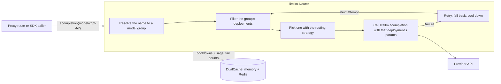

# Router

`litellm.Router` decides which deployment serves a request, makes the call, and handles what happens when the call fails. It retries in the same model group, falls back to other groups, and puts failing deployments into cooldown so the next requests avoid them. The proxy builds one Router from its config and sends every model request through it, and SDK users can build their own

The router is the first module going through the [Rust migration path](explanation/boundary-and-migration.md). Its public surface was narrowed to the endpoint methods plus eight entry points, so code outside the router no longer reaches into its internals. That is the state these pages describe

## Where to start

New to the router? Work through the tutorial, [Route your first requests](tutorial/route-your-first-requests.md). It builds a Router with mock deployments, so it needs no API keys, and shows load balancing, retries, cooldowns and fallbacks in about fifteen minutes

### How-to guides

- [Read router state from outside the router](how-to/read-router-state.md)
- [Change deployments or settings at runtime](how-to/change-the-router-at-runtime.md)
- [Move a caller off a deprecated Router member](how-to/move-off-deprecated-members.md)
- [Add a custom routing strategy](how-to/add-a-routing-strategy.md)
- [Find out why a request went where it did](how-to/debug-a-routing-decision.md)

### Reference

- [Entry points](reference/entry-points.md), every method on the public surface and what it replaced
- [Configuration and defaults](reference/configuration.md), constructor arguments, strategies and constants
- [Routing state and cache keys](reference/state-and-cache-keys.md), what the router stores and for how long
- [Code map](reference/code-map.md), which file holds what

### Explanation

- [Concepts](explanation/concepts.md), deployments, model groups, aliases, wildcards, teams and routing groups
- [The life of a request](explanation/request-lifecycle.md), the call stack from `acompletion` to the provider
- [How a deployment is picked](explanation/selection.md), the filter pipeline and the strategies
- [Retries, fallbacks and cooldowns](explanation/reliability.md)
- [Shared state across proxy pods](explanation/shared-state.md)
- [The public boundary and the Rust migration](explanation/boundary-and-migration.md)
