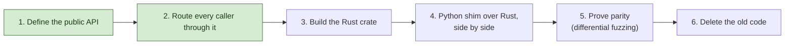
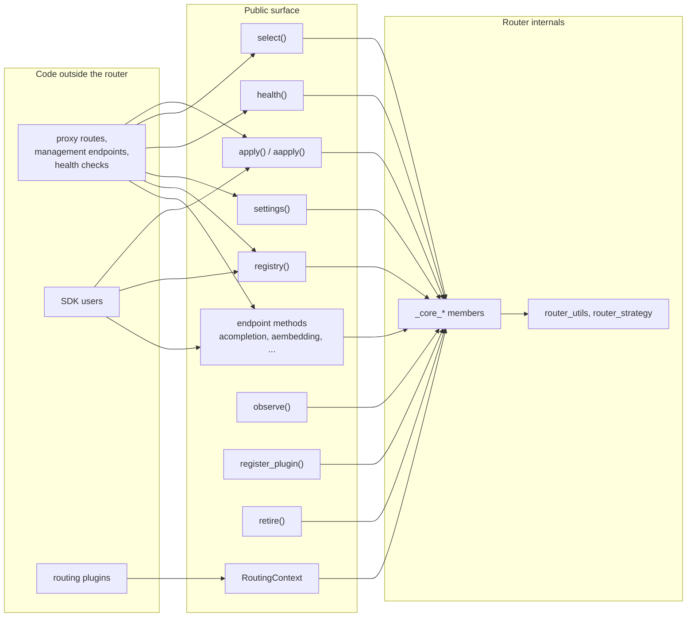
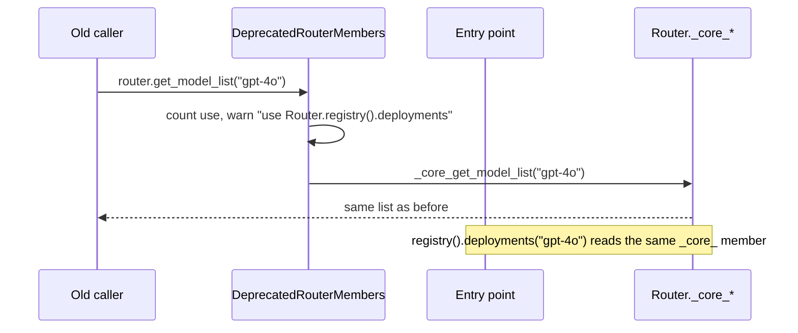
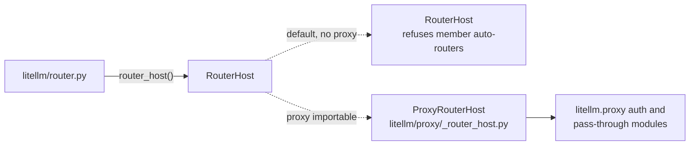
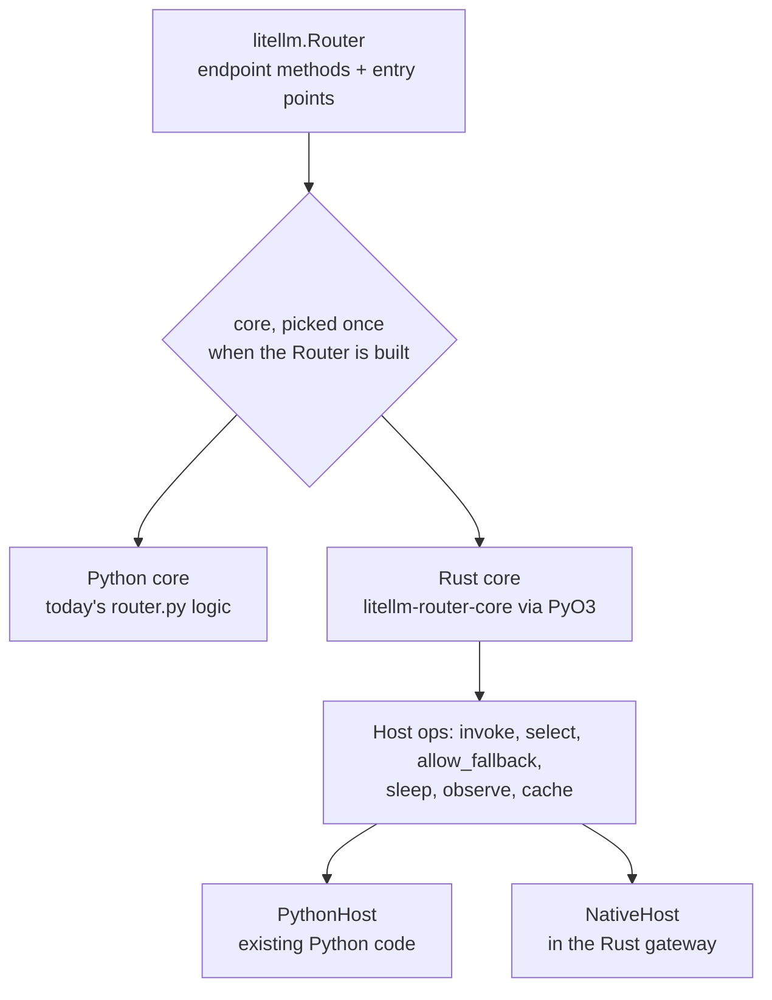

# The public boundary and the Rust migration

The router is the first module moved through the migration path every LiteLLM module follows on its way to Rust. This page explains what was done to the router's surface, why, and what comes next

Steps 1 and 2 are done for the router on the default branch. The rest are in progress

## Why the surface had to shrink

Before step 1, `Router` had about 700 members, and code outside `router.py` used 165 of them. Only five of those had underscore names, so the naming no longer said what was private. A Rust core cannot implement 165 loosely typed members that hand out live dicts, and every one of them was a place where Python and Rust could drift apart

So the router now has two kinds of public members. The endpoint methods (`acompletion`, `aembedding`, `aresponses`, `aanthropic_messages`, the files, batches, assistants and vector store wrappers) stay as they were. Everything else goes through eight entry points

Each entry point owns one kind of question. `registry()` answers what is configured. `settings()` answers how the router is configured. `health()` answers what state the deployments are in. `select()` picks without calling. `apply()` is the only way to change anything. `observe()`, `register_plugin()` and `retire()` cover the lifecycle. [Entry points](../reference/entry-points.md) lists every query and what it replaced

Routing plugins (strategies, pre-call checks, sub-routers) get a `RoutingContext` instead of the Router, which exposes the three views plus the few request-time helpers a plugin needs

## Keeping old callers working

Old member names still work through `DeprecatedRouterMembers` in `litellm/router_deprecated.py`, which `Router` mixes in. Each old name reads through the same `_core_*` implementation the entry point uses, returns the same type it always returned, and raises a `DeprecationWarning` that names its replacement. A write to an old setting name, such as `router.cooldown_time = 30`, becomes `apply(ChangeSet(assign={"cooldown_time": 30}))`, and assigning a new `router.model_list` bumps the registry version. Uses from outside the router are counted in `DEPRECATED_ROUTER_MEMBER_USES`, so the remaining callers can be found before the mixin is deleted

## Keeping the surface small

`tests/code_coverage_tests/router_surface_check.py` runs in CI. It scans every non-test file under `litellm/` and `enterprise/` for Router member uses and `litellm.router_utils` imports, and compares them with `router_surface_allowlist.json`. The list is shrink-only. A new outside use fails the check, and so does a listed entry nothing uses anymore, so the entry is removed in the same PR that removed the last use. Uses from the router family (`router_utils`, `router_strategy`) are listed separately, because those modules become private parts of the core later

## Settings are snapshots, the registry is versioned

`settings()` returns a frozen `RouterSettings` built once and cached until a setting attribute changes, so the request path can read it cheaply. Its fields are the router's own objects, not copies. The registry carries a `version` that goes up on every deployment change (`apply`, `set_model_list`, add, upsert, delete), so a caller can tell whether what it read is still current

On the default branch a direct assignment to an old setting attribute (`router.cooldown_time = 30`) still replaces the setting. The design the core is moving to treats settings as fixed after construction, with `apply(ChangeSet(...))` as the only way to change them. New code should use `apply` already

## The host

The router used to import three proxy modules inside functions, while the proxy imported the router, so the two depended on each other. Now the router asks a `RouterHost` (`litellm/router_host.py`) for anything only the application can answer: vertex pass-through credentials, member auto-router authorization, and auto-router prompt compression. The first time it asks, it installs the proxy's host (`litellm/proxy/_router_host.py`) if the proxy can be imported, and a default host otherwise. `router.py` itself never imports the proxy

## Where Rust comes in

`litellm-rust/crates/router-core` holds the interface the Rust core will implement, written down as a crate-level doc before any code. It follows the same split. A `Registry`, `Settings` and `Health` view, `select`, `apply` with one atomic `ChangeSet`, and `call(op, request)` that selects, runs the attempt, and retries or falls back. What the core needs from its environment comes through a `Host`, which invokes operations Rust does not run natively, runs strategies not yet ported, checks fallback access and budget, sleeps, reports routing events, and provides the DualCache-style store, so Python and Rust workers read and write the same cooldown and usage keys

The Python core and the Rust core will run side by side, picked once per Router, and differential fuzzing (litefuzz) has to show they behave the same before the Rust core becomes the default and the Python one is deleted. The small `litellm-rust/crates/router` crate that exists today only maps the gateway's config to deployments and does no routing. It is not the core
