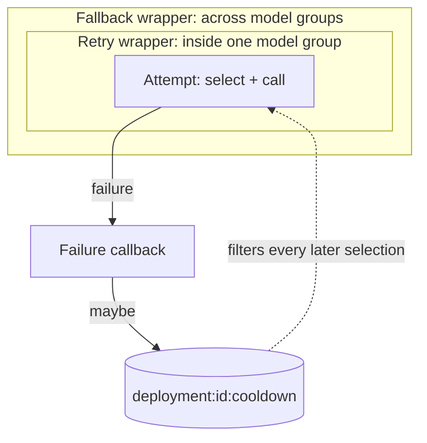
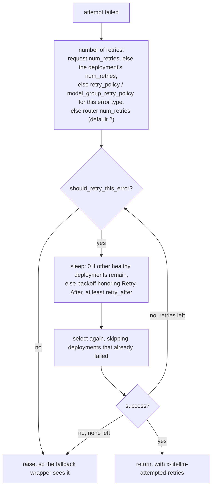
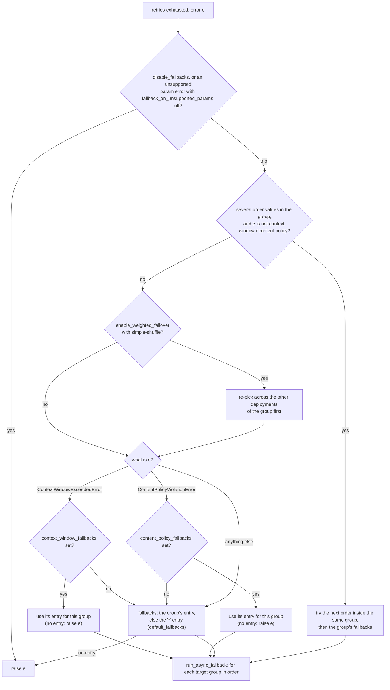
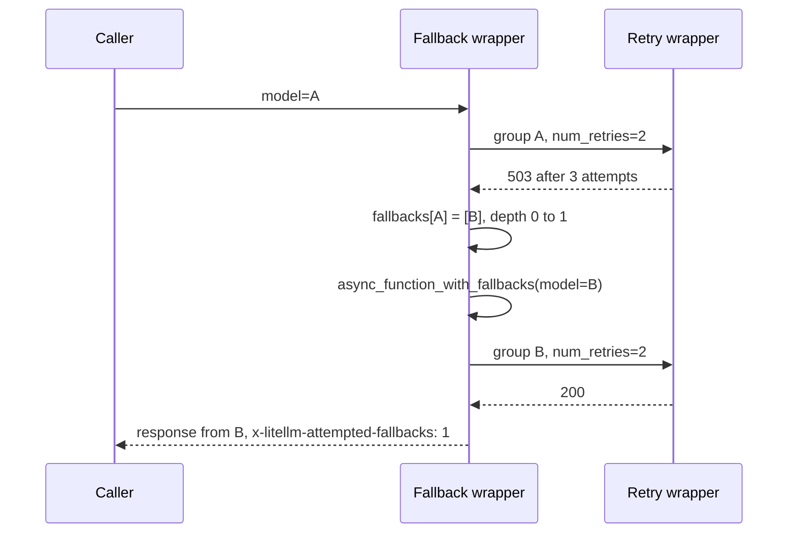
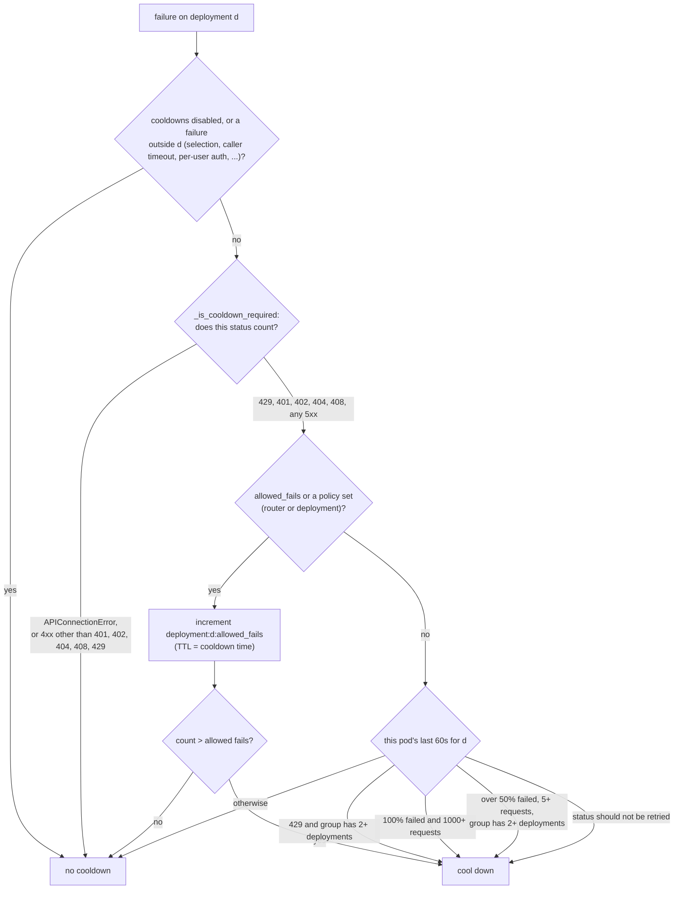

# Retries, fallbacks and cooldowns

The router has three tools for failures, and they work at different scopes. A retry tries the same model group again, and selection can land on a different deployment. A fallback moves the request to a different model group. A cooldown takes one deployment out of selection for every request, for a few seconds

## Retries

`async_function_with_retries` runs the first attempt. When it fails, the router works out how many retries this request gets, decides whether this error is worth retrying, waits, and loops

`should_retry_this_error` raises at once instead of retrying in these cases. A context window error when `context_window_fallbacks` is set, and a content policy error when `content_policy_fallbacks` is set, because a fallback will do better than another deployment of the same model. A status code `litellm.should_retry` says not to retry, other than 401 and 403. A `NotFoundError`. A rate limit when no healthy deployment is left and fallbacks exist. An auth or permission error in a group with a single deployment. And any error when no healthy deployment is left. When a retry policy matched the error type, its count is used and these checks are skipped

The sleep is zero while other healthy deployments remain, since the next attempt can go somewhere else. With a single deployment, or none healthy, the router backs off with `litellm.calculate_retry_after`, which honors the provider's `Retry-After` header and the router's `retry_after` minimum

## Fallbacks

`async_function_with_fallbacks` calls the retry wrapper. When the retry wrapper gives up, `async_function_with_fallbacks_common_utils` chooses where to go next

Each list is a list of single-key dicts that map a model group to an ordered list of groups to try, for example `fallbacks=[{"gpt-4o": ["claude-sonnet", "gpt-4o-mini"]}]`. `default_fallbacks=["gpt-4o-mini"]` becomes the catch-all entry `{"*": ["gpt-4o-mini"]}`

`run_async_fallback` in `litellm/router_utils/fallback_event_handlers.py` walks the target list. For each target it checks `fallback_access_check` (may this caller use that group) and `fallback_budget_check`, skips targets this request already tried, then calls `async_function_with_fallbacks` again with the new model. So each hop gets its own full retry loop, and can fall back further. A hop counter `fallback_depth` stops the walk at `max_fallbacks` (default 5, or the `ROUTER_MAX_FALLBACKS` environment variable)

With `fallbacks=[{"A": ["B"]}]`, `context_window_fallbacks=[{"A": ["A-long"]}]` and `num_retries=2`, a 503 from A is retried twice in A, then the request goes to B with two retries of its own. A context window error from A is not retried at all, since a context window fallback exists, and goes straight to A-long

Streaming has one more layer. If a stream fails after it started, `FallbackAwareStreamWrapper` can continue on a fallback group mid-stream when `enable_mid_stream_fallback_continuation` is on, combining the usage of both parts

## Cooldowns

A cooldown is a key `deployment:{id}:cooldown` in the router's cache, with a TTL equal to the cooldown time. While the key exists, the cooldown filter drops the deployment from every selection, on every pod that shares the Redis. When the TTL expires the deployment is simply eligible again. There is no probe request and no early reset on success

The failure callback, `deployment_callback_on_failure`, decides whether a failure cools the deployment down. It runs two checks, first on the error and then on the deployment's recent history

The cooldown time comes from the deployment's own `cooldown_time` if it sets one, then the provider's `Retry-After` header, then the router's `cooldown_time`, which defaults to 5 seconds (`DEFAULT_COOLDOWN_TIME_SECONDS`)

Two details are easy to miss. The success and failure counts for the error-rate rule are kept in memory only, per pod, with a 60 second TTL, so on a fleet each pod judges a deployment by the traffic it saw itself. The `allowed_fails` counter and the cooldown key itself live in Redis when it is configured, so they apply to the whole fleet. And by default a lone deployment is protected from the error-rate rule, since cooling down the only deployment of a group would fail every request for that group

When every candidate is cooled down, selection raises `RouterRateLimitError` with the time until the soonest cooldown ends. `enable_health_check_routing` changes this, by ignoring cooldowns for the request when they would leave nothing
