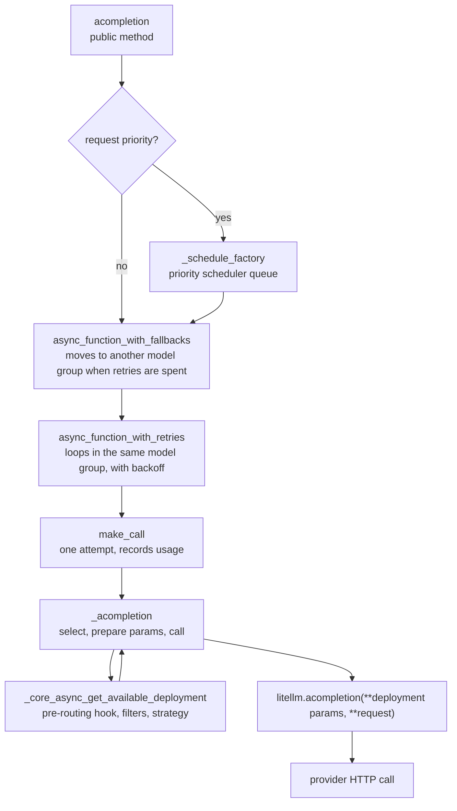
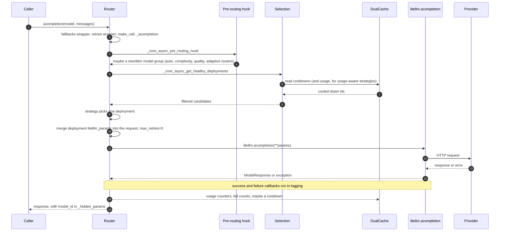
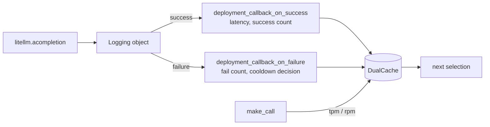

# The life of a request

This page follows one `await router.acompletion(model="gpt-4o", messages=...)` from the public method to the provider call and back. The other endpoint methods (`aembedding`, `aresponses`, `aanthropic_messages`, the files and batches wrappers and the rest) have the same shape with a different inner function. Line numbers drift, so search for the method names in `litellm/router.py`

## The call stack

Fallbacks wrap retries, and retries wrap a single attempt. Each attempt selects a deployment and calls it

`acompletion` itself does little. It stores the model and messages in `kwargs`, records the model group in the request metadata (`_update_kwargs_before_fallbacks`), splits off a request priority if there is one, and hands the request to `async_function_with_fallbacks`, directly or through the priority scheduler. Prompt-management models (a prompt id that resolves to a model) take a separate path

## One attempt, in order

Some details worth knowing

The router sets `max_retries` to 0 in `default_litellm_params`, so neither the provider SDK nor the HTTP client retries on its own. The router's loop is the only retry loop, which lets each retry pick a different deployment

Selection happens inside the attempt, not before the wrappers. That is why a retry can land on a different deployment. Deployments that already failed for this request are skipped on retry through `_retry_skipped_deployment_ids`

`litellm.acompletion` is the same function SDK users call. The router does not talk to providers itself. It chooses the arguments, and the provider transformation layer does the rest

The response carries the chosen deployment's id in `response._hidden_params["model_id"]`, and the proxy reports it in the `x-litellm-model-id` header

## How results flow back into routing

The router learns about outcomes in two ways. `make_call` increments the per-minute tpm and rpm counters for the deployment after each successful response. The Router also registers its own `deployment_callback_on_success` and `async_deployment_callback_on_failure` with LiteLLM's logging callbacks when it is built, so every completed call, success or failure, is reported back to it

Strategies that track usage or latency (`usage-based-routing-v2`, `latency-based-routing`, `least-busy`, `cost-based-routing`) also register their own logging handlers, which update the counters those strategies read. `router.observe(request_scoped=True)` switches the router from global callback registration to binding these observers to each request's logging object instead

## The sync path

`router.completion()` reuses the async wrappers. `function_with_fallbacks` runs `async_function_with_fallbacks` to completion with `run_async_function`, and the inner `_completion` selects with the sync `get_available_deployment` and calls `litellm.completion`. Some newer features exist only on the async path, for example `enable_weighted_failover`. The proxy uses the async methods for every request
