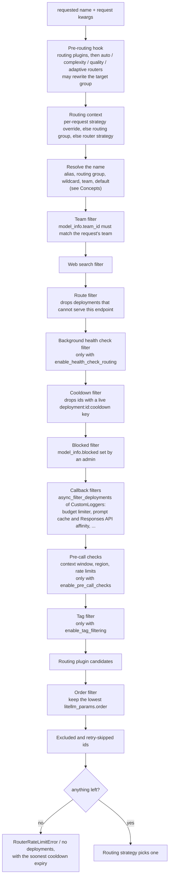
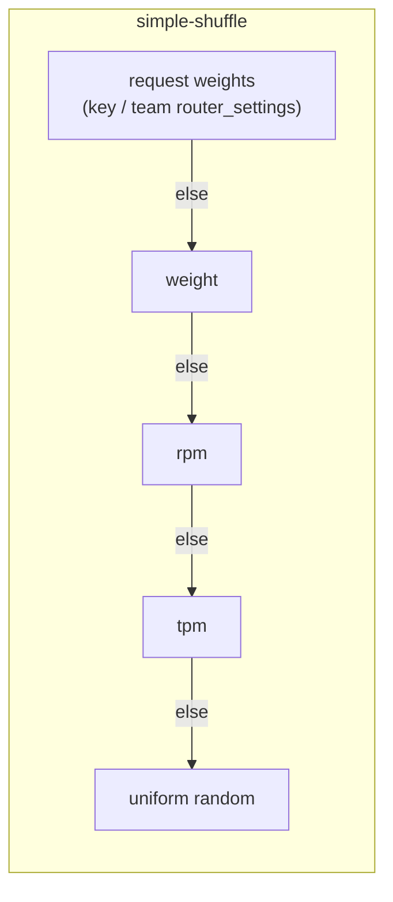
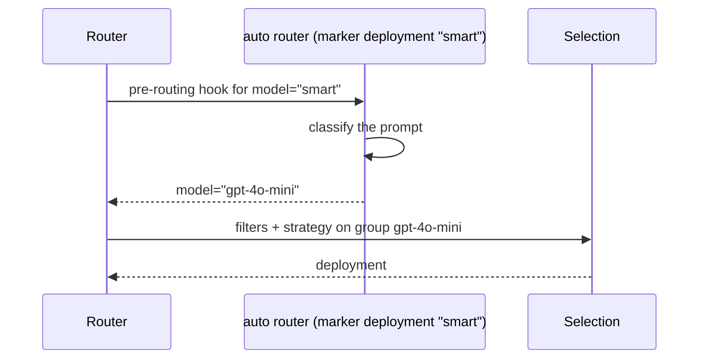

# How a deployment is picked

Selection turns a requested name into one deployment. It runs inside every attempt, so a retry selects again. The entry is `_core_async_get_available_deployment` (the public way in is `router.select()`), and most of the work happens in `_core_async_get_healthy_deployments`. Both are in `litellm/router.py`

## The pipeline

Each stage can only remove candidates or replace the requested group. The strategy at the end sees what is left

Two exceptions to "only remove" are worth knowing. When `enable_health_check_routing` is on and the cooldown filter would leave nothing, the router ignores cooldowns for that request and logs a warning. And when the name resolves to exactly one deployment as a dict (a deployment id, or `specific_deployment=True` with one match), most filters and the strategy are skipped and that deployment is returned

The `order` filter is how in-group priority works. Deployments with `order: 1` take all traffic while any of them pass the filters. The ones with `order: 2` only see traffic when the fallback wrapper retries the group with `_target_order` set, after the lower order is exhausted (see [Retries, fallbacks and cooldowns](reliability.md))

## Strategies

The strategy is the last step. It gets the filtered list and returns one deployment. `RoutingStrategyName` in `litellm/types/litellm_params.py` lists the names a Router accepts

| Strategy | Picks | Reads | Code |
| --- | --- | --- | --- |
| `simple-shuffle` (default) | a weighted random deployment | per-request weights, then `weight`, then `rpm`, then `tpm`, else uniform | `router_strategy/simple_shuffle.py` |
| `least-busy` | the deployment with the fewest requests in flight | in-flight counters | `router_strategy/least_busy.py` |
| `usage-based-routing-v2` | the deployment with the lowest tpm this minute that stays under its tpm and rpm | `global_router:{id}:...` counters | `router_strategy/lowest_tpm_rpm_v2.py` |
| `usage-based-routing` | the v1 version of the above, kept for old configs | per-minute usage | `router_strategy/lowest_tpm_rpm.py` |
| `latency-based-routing` | the lowest recent latency, or time to first token for streams, within a buffer | latency samples | `router_strategy/lowest_latency.py` |
| `cost-based-routing` | the cheapest deployment still under its limits | model cost map, usage | `router_strategy/lowest_cost.py` |
| `lar1` | a deployment by the caller's confidence level (LAR-1), with thresholds from `routing_strategy_args` | `metadata.lar1` on the request | `router_strategy/lar1_routing.py` |

Routing groups can also use `priority`, which tries member groups by `model_priorities` and shares traffic between equal priorities. `register_plugin()` replaces the strategy entirely with your own, see [Add a custom routing strategy](../how-to/add-a-routing-strategy.md)

Per-request weights come from key or team level `router_settings`. The proxy validates them into the request as `{model_group: {deployment_id: weight}}`, so one team can send most of a group's traffic to one deployment while everyone else gets the global split, without a separate Router per team

## Sub-routers are plugins

The auto router, complexity router, quality router and adaptive router are not strategies. Each is configured as a deployment whose `litellm_params.model` starts with a marker such as `auto_router/`, and it runs in the pre-routing hook. It looks at the request, decides which model group should serve it, and returns a rewritten model. Normal selection then runs on that group. Marker deployments are dropped from candidate lists so they are never called directly

The router asks the application it runs in whether the caller may use a sub-router (`RouterHost.authorize_strategy_inference`), because member auto-routers need the proxy's team checks. See [The public boundary](boundary-and-migration.md) for the host

## Usage-aware strategies and Redis reads

The cooldown filter and `usage-based-routing-v2` each need a Redis read before a deployment can be picked, and they live in different objects. `RoutingReadBatch` in `litellm/router_utils/routing_read_batch.py` fetches both key sets in one round trip while the candidates are being resolved and hands the usage part to the strategy, so selection does not read again
