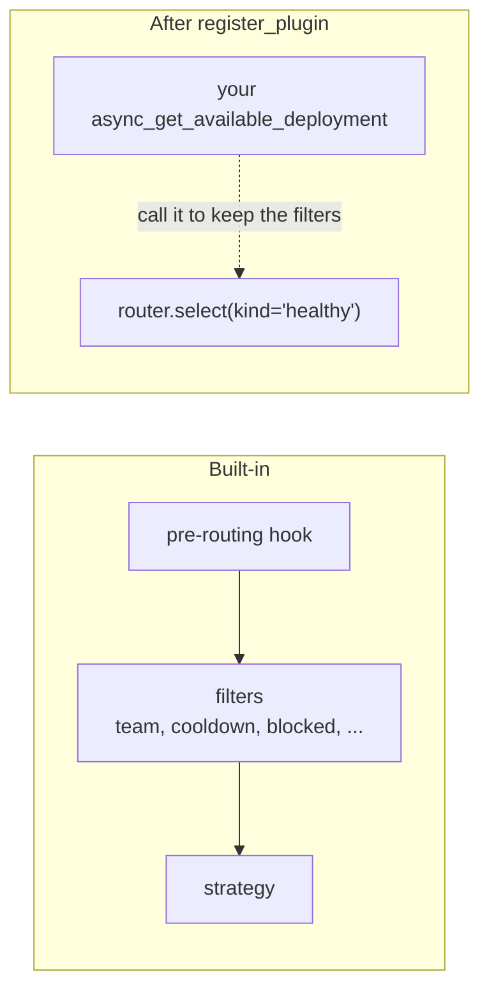

# Add a custom routing strategy

Use this guide when none of the built-in strategies picks deployments the way you need and you want to plug your own in without changing `router.py`. You write a `CustomRoutingStrategyBase` and register it with `router.register_plugin()`

## Know what you replace

`register_plugin` replaces the router's whole selection step, not only the strategy at its end. Your method is called where `_core_async_get_available_deployment` used to be, so the pre-routing hook, the filters and the built-in strategy no longer run unless you call them



To keep cooldowns, team checks and the other filters, ask the router for the filtered candidates with `select(kind="healthy")` and only choose among them, as the example does

## Write the strategy

```python
from litellm import Router
from litellm.types.router import CustomRoutingStrategyBase


class LowestIdStrategy(CustomRoutingStrategyBase):
    def __init__(self, router: Router) -> None:
        self.router = router

    async def async_get_available_deployment(
        self, model, messages=None, input=None, specific_deployment=False, request_kwargs=None
    ):
        healthy = await self.router.select(
            model,
            request_kwargs,
            kind="healthy",
            messages=messages,
            input=input,
            specific_deployment=specific_deployment,
        )
        if isinstance(healthy, dict):  # the name resolved to one specific deployment
            return healthy
        return min(healthy, key=lambda d: d["model_info"]["id"])

    def get_available_deployment(
        self, model, messages=None, input=None, specific_deployment=False, request_kwargs=None
    ):
        raise NotImplementedError("this strategy serves the async path only")
```

The method returns one deployment dict from the model list. `select(kind="healthy")` raises the router's usual no-deployments error when everything is filtered out, so you do not need your own

## Register it

```python
router = Router(model_list=[...])
router.register_plugin(LowestIdStrategy(router))
```

From here on every `acompletion`, `aembedding` and the other async endpoint methods route through it. `get_available_deployment` serves `router.completion()` and the other sync methods, so implement it too if you use them

## Check it

`router.select(model)` now returns your pick without calling the provider, which makes the strategy easy to unit test with mock deployments. [The tutorial](../tutorial/route-your-first-requests.md) shows how to build a Router with `mock_response` deployments

## When a plugin is the better fit

If you only need to narrow the candidates, or to send some requests to a different model group, you do not need to replace selection. A deployment-level filter fits as a `CustomLogger` that implements `async_filter_deployments` and is added to `litellm.callbacks`, which the router calls in its callback filter stage. Choosing a model group per request is what the sub-routers in `litellm/router_strategy/auto_router/` and its siblings do in the pre-routing hook. Both keep the rest of the pipeline intact. See [How a deployment is picked](../explanation/selection.md) for where each stage runs
