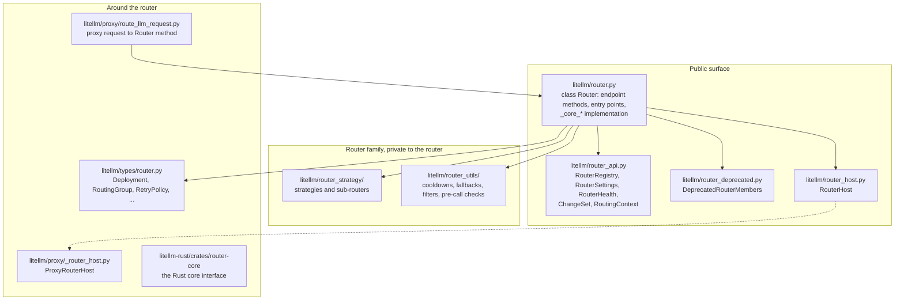

# Code map

Where the router's code lives. Paths are relative to the repo root

## The router itself

| File | Holds |
| --- | --- |
| `litellm/router.py` | `Router`, every endpoint method, selection, retries, fallbacks, the success and failure callbacks, and the `_core_*` members the entry points read |
| `litellm/router_api.py` | the entry point views and types, see [Entry points](entry-points.md) |
| `litellm/router_deprecated.py` | the old member names, implemented over the entry points with a `DeprecationWarning` |
| `litellm/router_host.py` | what the router asks of the application it runs in |

## `litellm/router_strategy/`

| File | Holds |
| --- | --- |
| `simple_shuffle.py` | weighted random pick |
| `least_busy.py` | fewest requests in flight |
| `lowest_tpm_rpm.py`, `lowest_tpm_rpm_v2.py` | usage-based routing v1 and v2 |
| `lowest_latency.py` | latency-based routing |
| `lowest_cost.py` | cost-based routing |
| `lar1_routing.py` | LAR-1 confidence routing |
| `base_routing_strategy.py` | batching of in-memory counter increments to Redis |
| `budget_limiter.py` | provider, deployment and tag budgets, a filter |
| `tag_based_routing.py` | the tag filter |
| `auto_router/`, `complexity_router/`, `quality_router/`, `adaptive_router/` | sub-routers that pick a model group in the pre-routing hook |

## `litellm/router_utils/`

| File | Holds |
| --- | --- |
| `cooldown_handlers.py` | whether a failure cools a deployment down, and reading active cooldowns |
| `cooldown_cache.py` | the cooldown store |
| `cooldown_callbacks.py` | alerts and metrics fired when a deployment is cooled down |
| `router_callbacks/track_deployment_metrics.py` | per-pod success and fail counts |
| `fallback_event_handlers.py` | `run_async_fallback`, the walk over fallback targets |
| `get_retry_from_policy.py` | retries per error type from a `RetryPolicy` |
| `add_retry_fallback_headers.py`, `response_headers.py` | `x-litellm-attempted-retries` and related headers |
| `handle_error.py` | the error raised when no deployment is left |
| `pattern_match_deployments.py` | wildcard routes |
| `routing_groups.py` | priority ordering inside routing groups |
| `common_utils.py` | the team filter and other shared helpers |
| `access_windows.py` | deployments reserved for a team during a time window |
| `endpoint_eligibility.py` | which deployments can serve which endpoint |
| `health_state_cache.py` | background health check results |
| `routing_read_batch.py` | one Redis round trip for cooldown and usage reads |
| `pre_call_checks/` | context window, rate limit, affinity and prompt caching checks |
| `client_initalization_utils.py` | provider client setup per deployment |
| `request_priority.py`, `ptu_shares.py`, `reasoning_effort_capability.py`, `deployment_pricing.py` | request priority, PTU shares, reasoning effort support, deployment pricing names |

## Tests and checks

| Path | What it covers |
| --- | --- |
| `tests/unit/test_router/` | router unit tests, including `test_router_entry_points.py` and `test_router_host.py` |
| `tests/unit/test_router_*.py` | focused router regressions |
| `tests/code_coverage_tests/router_surface_check.py` | the shrink-only surface allowlist, run in CI |
| `tests/code_coverage_tests/router_code_coverage.py` | every router function has a test |
