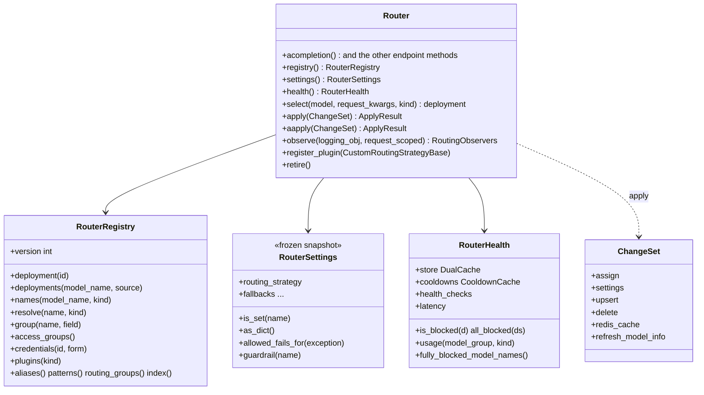

# Entry points

`litellm.Router` exposes its endpoint methods plus the entry points below. Code outside the router uses nothing else, and `router_surface_check.py` enforces that in CI. The views and types are in `litellm/router_api.py`, and the entry point methods are at the top of `class Router` in `litellm/router.py`

## `registry()` returns `RouterRegistry`

Read-only queries over the configured deployments. The object is cached on the Router and reads live state on each call

| Query | Returns | Replaces |
| --- | --- | --- |
| `version` | an int that goes up on every deployment change | |
| `deployment(id)` | `Deployment` or None | `get_deployment` |
| `has_deployment(id)` | bool | `has_model_id` |
| `deployment_dict(id)` | the deployment as its model_list dict | `get_model_info` |
| `deployment_model_info(id, model_name)` | model info merged with the pricing map | `get_deployment_model_info` |
| `router_model_info(...)`, `discovered_model_info(id)`, `zero_cost()` | routing model info, provider-discovered limits, the zero-cost lookup | `get_router_model_info`, `get_discovered_model_info`, `_zero_cost_cache` |
| `deployments(name, source="group")` | the group, its aliases, routing groups, then wildcards | `get_model_list` |
| `deployments(name, source="all")` | every deployment of the group | `get_all_deployments` |
| `deployments(source="config")` | deployments from config, not the DB | `config_deployments` |
| `deployments(name, source="routable", request=, call_type=)` | deployments that pass the routing checks for a request | `get_routable_deployments` |
| `deployments(name, source="first_in_group")` | the first deployment of a group | `get_deployment_by_model_group_name` |
| `deployments(name, source=...)` | also `named`, `alias`, `routing_groups`, `routed_group`, `wildcard`, `for_request` | see the docstring |
| `all()` | the live model list | `model_list` |
| `names(kind="groups")` | every routable model name | `get_model_names` |
| `names(kind="group_set")` | the set of configured group names | `model_names` |
| `names(name, kind="ids")` | deployment ids, of one group or all | `get_model_ids` |
| `names(kind=...)` | also `deployment_names`, `team_public`, `litellm_models`, `litellm_base_models`, `wildcard`, `route_candidates` | see the docstring |
| `resolve(name, kind="group")` | the model group a name routes to | `routable_model_group` |
| `resolve(name, kind="alias")` | the alias target, or None | `get_model_from_alias` |
| `resolve(name, kind="team_model", team_id=)` | a team's public name to its group | `map_team_model` |
| `resolve(name, kind="recognized")` | whether the router knows the name | `is_recognized_model` |
| `resolve(id, kind="group_of_id")` | the group of a deployment id | `get_model_group` |
| `resolve(name, kind=...)` | also `served`, `from_id`, `upstream`, `wildcard_access_group`, `team_model_alternatives`, `routing_group_alternatives`, `search_tool_support` | see the docstring |
| `group(name, field="info")` | merged `ModelGroupInfo` | `get_model_group_info` |
| `group(name, field=...)` | also `cached_info`, `display_name`, `mode`, `service_tiers`, `token_limits`, `listing_info` | see the docstring |
| `access_groups(...)` | access group name to model names | `get_model_access_groups` |
| `credentials(id, form="params")` | a deployment's credentials | `get_deployment_credentials` |
| `plugins(kind)` | `auto`, `complexity`, `quality`, `adaptive` sub-routers, `routing` plugins, `budget_limiter`, `prompt_caching_pins` | `auto_routers` and friends |
| `aliases()`, `patterns()`, `routing_groups()`, `index(name)` | the alias map, the wildcard router, routing groups, the name index | the old attributes |

Module-level helpers in the same file need no Router. `deployment_id(model_group, litellm_params)` computes the stable id of a deployment that has none (was `Router.generate_model_id`). `deployment_usable_by_team(deployment, team_id)` says whether a team may use a deployment

## `settings()` returns `RouterSettings`

A frozen dataclass with one field per readable setting, listed in `SETTING_FIELDS`. It is built once and reused until a setting changes. Fields hold the router's own objects, not copies, and a setting the router never set reads as None

`routing_strategy`, `fallbacks`, `context_window_fallbacks`, `content_policy_fallbacks`, `default_deployment`, `default_litellm_params`, `default_max_parallel_requests`, `cooldown_time`, `allowed_fails`, `allowed_fails_policy`, `disable_cooldowns`, `enable_pre_call_checks`, `enable_health_check_routing`, `health_check_ignore_transient_errors`, `background_health_check_model_groups`, `enable_tag_filtering`, `tag_filtering_match_any`, `tag_routing_prefix`, `router_general_settings`, `provider_budget_config`, `provider_default_deployment_ids`, `fallback_access_check`, `fallback_budget_check`, `kubernetes_pod_discovery`, `search_tools`, `guardrail_list`, `cache_responses`

| Method | Returns | Replaces |
| --- | --- | --- |
| `is_set(name)` | whether the router has this setting at all | |
| `as_dict()` | the runtime-updatable settings as plain values | `get_settings` |
| `allowed_fails_for(exception)` | allowed fails for an error under `allowed_fails_policy` | `get_allowed_fails_from_policy` |
| `guardrail(name)` | a configured guardrail | `get_available_guardrail` |

## `health()` returns `RouterHealth`

| Member | Returns | Replaces |
| --- | --- | --- |
| `store` | the routing state `DualCache` | `cache` |
| `cooldowns` | the `CooldownCache` | `cooldown_cache` |
| `health_checks` | background health check results | `health_state_cache` |
| `latency` | latency samples by deployment | `deployment_latency_map` |
| `is_blocked(deployment)`, `all_blocked(deployments)` | whether an admin paused them | `is_deployment_blocked`, `are_all_deployments_blocked` |
| `fully_blocked_model_names()` | groups with every deployment paused | `get_fully_blocked_model_names` |
| `await fully_unhealthy_model_names()` | groups with every deployment failing health checks | `async_get_fully_unhealthy_model_names` |
| `await usage(group, kind="current")` | tpm and rpm this minute | `get_model_group_usage` |
| `await usage(group, kind="remaining")` | what is left of the group's limits | `get_remaining_model_group_usage` |
| `team_ptu_ceiling(team_id, group)` | a team's PTU share ceiling | `team_ptu_ceiling` |
| `split_priority(model, kwargs)` | the request priority and the kwargs without it | `split_request_priority` |

## `select(model, request_kwargs=None, *, kind="pick", ...)`

Runs selection without calling the provider. `kind="pick"` returns one deployment dict, exactly what a real request would get (was `async_get_available_deployment`). `kind="healthy"` returns the filtered candidates before the strategy (was `async_get_healthy_deployments`). `kind="pass_through"` picks among deployments with `use_in_pass_through=True`. Optional keyword arguments are `messages`, `input`, `specific_deployment`, `parent_otel_span` and `health_check_probe`

## `apply(changes)` and `aapply(changes)`

The only way to change a Router after it is built. `ChangeSet` fields are applied in this order

| Field | Effect | Replaces |
| --- | --- | --- |
| `assign` | replace settings fields as they are, names from `SETTING_FIELDS` only | `router.<field> = value` |
| `settings` | validated runtime settings | `update_settings(**settings)` |
| `upsert` | add or replace deployments, by `model_info.id` | `upsert_deployment` |
| `delete` | remove deployments by id | `delete_deployment` |
| `redis_cache` | point routing state at a new Redis cache | `update_redis_cache` |
| `refresh_model_info` | re-read discovered model info, `aapply` only | `arefresh_model_info` |

Both return `ApplyResult(version, upserted, deleted)`, with the registry version after the change and, per upsert or delete, the deployment that was there before

## Lifecycle

`observe(logging_obj=None, *, request_scoped=False)` returns the router's `RoutingObservers`. With `request_scoped=True` the router stops registering its callbacks globally, and passing a request's `logging_obj` binds them to that request. `register_plugin(strategy)` replaces the routing strategy with a `CustomRoutingStrategyBase`. `retire()` releases the router's global callback registrations and routing state, for a Router that is being replaced (was `discard`)

## `RoutingContext`

What a routing plugin receives instead of the Router. It has `registry()`, `settings()` and `health()`, plus `pre_call_checks`, `count_pre_call_check_tokens`, `update_kwargs_before_fallbacks`, `arm_read_prefetch`, `pre_routing_hook` and `log_retry`
