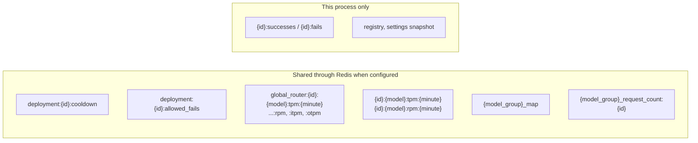

# Routing state and cache keys

Everything the router remembers between requests, where it lives, and how long it lasts. A Rust core has to read and write the same keys with the same encodings and TTLs, so Python and Rust workers can share one Redis. `{id}` is the deployment's `model_info.id`, `{minute}` is the UTC time as `HH-MM`

| Key | Written by | Read by | Value | TTL | Tiers |
| --- | --- | --- | --- | --- | --- |
| `deployment:{id}:cooldown` | `CooldownCache.add_deployment_to_cooldown` | the cooldown filter, `health().cooldowns` | exception text, status code, timestamp, cooldown time | the cooldown time | `CooldownCache`'s own DualCache, memory re-checked against Redis every 1s |
| `deployment:{id}:allowed_fails` | `should_cooldown_based_on_allowed_fails_policy` | the same | fail count | the cooldown time | memory + Redis |
| `deployment:{id}:allowed_fails:{suffix}` | the same, with a deployment-level policy | the same | fail count per error type | the cooldown time | memory + Redis |
| `{id}:successes`, `{id}:fails` | `track_deployment_metrics.py` | the default error-rate cooldown rule | count | 60s | memory only |
| `global_router:{id}:{model}:tpm:{minute}`, `:rpm:` | `Router._increment_deployment_usage` after each response | pre-call rate limit checks, `health().usage()` | count | 60s | Redis pipeline increment, memory |
| `global_router:{id}:{model}:itpm:{minute}`, `:otpm:` | `pre_call_checks/io_token_rate_limit_check.py` | the same check, `Router.get_model_group_io_token_usage` | input and output token counts | 60s | memory + Redis |
| `{id}:{model}:tpm:{minute}`, `{id}:{model}:rpm:{minute}` | `LowestTPMLoggingHandler_v2` | `usage-based-routing-v2` | count | 60s | memory, pushed to Redis every 1s |
| `{model_group}_map` | `LowestLatencyLoggingHandler` | `latency-based-routing` | latency and ttft samples per deployment | `routing_strategy_args.ttl`, 1 hour | memory + Redis |
| `{model_group}_request_count:{id}` | `LeastBusyLoggingHandler` | `least-busy` | requests in flight | 1 hour | memory + Redis |

Key templates for the usage counters are `RouterCacheEnum` in `litellm/types/router.py`. Other strategies and filters keep their own keys (the budget limiter, prompt cache pins, deployment and session affinity), and each documents them in its module under `litellm/router_strategy/` or `litellm/router_utils/pre_call_checks/`

## Process-local state

Some state is per Router instance and is never shared. The deployment list and its indexes, with `registry().version`. The cached `settings()` snapshot. Provider clients, cached per deployment for `client_ttl` seconds. The background health check results in `health().health_checks`. These are rebuilt from config on every pod, which is why deployment ids must be stable across pods
